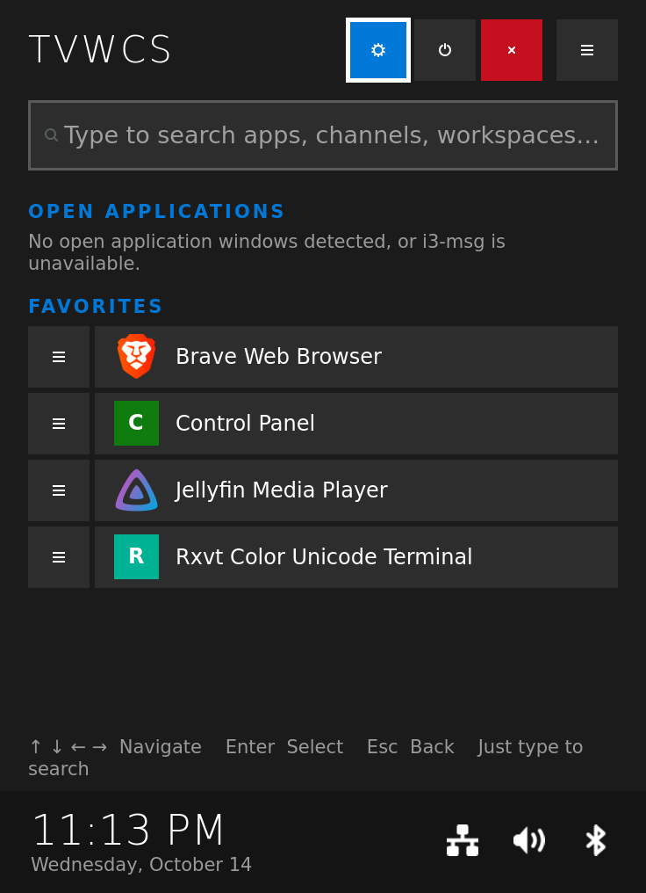
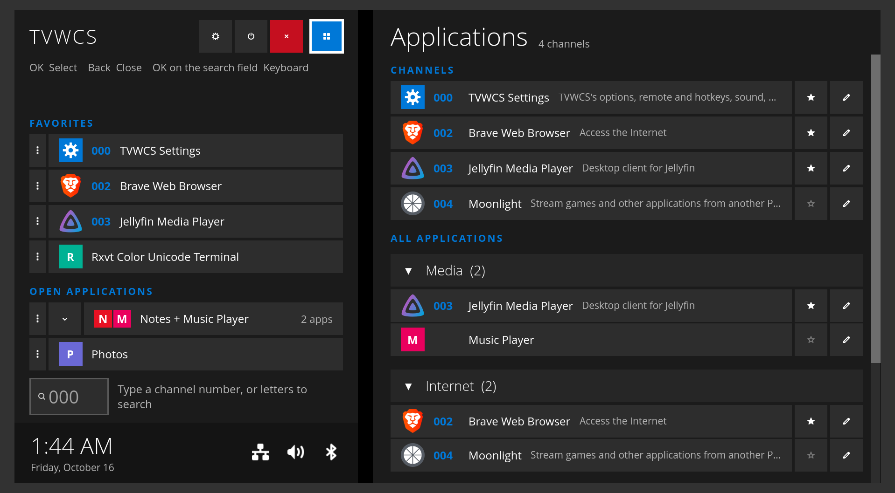
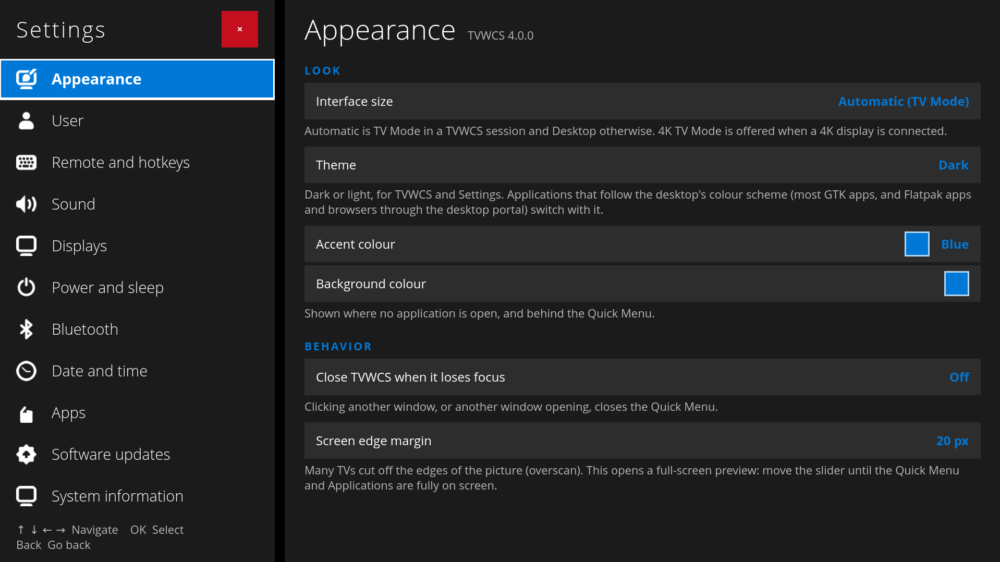

# TVWCS

TVWCS (TV Window Channel Switcher) lets you use an ordinary Linux computer from the couch with a remote. It runs on top of the i3 or sway window manager and gives you:

- a **Quick Menu** at the left of the screen: search, your open apps and your favorites;
- an **Applications** pane beside it: every installed app by category, plus your own numbered **Channels**;
- a **Settings** app for the things a TV computer needs: sound, displays, Wi-Fi, Bluetooth, power, updates and more.

It works with normal desktop apps. It is not a media center and needs no plugins. What's new is in [CHANGELOG.md](CHANGELOG.md).

<table>
  <tr>
    <th width="25%">Quick Menu</th>
    <th width="75%">Quick Menu and Applications</th>
  </tr>
  <tr>
    <td valign="top"></td>
    <td valign="top"></td>
  </tr>
  <tr>
    <td valign="top">Buttons at the top: ⚙ Settings, ⏻ power menu, ✕ close, ⊞ Applications. Below: search, <b>Open applications</b> (by workspace) and <b>Favorites</b>. At the bottom: key hints, the clock, and icons for network, volume, Bluetooth and updates.</td>
    <td valign="top"><b>Channels</b> lists apps you gave a number. <b>All applications</b> lists every app by category; OK/Enter folds a category. ☆ makes an app a favorite, ✎ edits its launch profiles.</td>
  </tr>
  <tr>
    <th colspan="2">Settings › Options</th>
  </tr>
  <tr>
    <td colspan="2"></td>
  </tr>
  <tr>
    <td colspan="2" valign="top">Each row shows its current value on the right. OK/Enter changes it.</td>
  </tr>
</table>

## What you need

- **Debian or a Debian-based system** (Ubuntu, Linux Mint, Pop!_OS, Raspberry Pi OS).
- **systemd.**
- i3 4.20 or newer, or sway. The installer can install i3 for you.
- Python 3.9 or newer with GTK 4 (PyGObject). The installer lists and installs anything missing.

Other distributions and systems without systemd are not supported. [TODO.md](TODO.md) records what it would take to bring them back.

**On a system that isn't Debian-based**, TVWCS's own windows may still run if you install its packages by hand, but:

- the installer can't install anything: it only knows apt and Debian's package names, so it lists what is missing and stops;
- **Software updates** can't check for or install system updates (apt only); Flatpak and TVWCS's own updates still work;
- **System information** can't install the SSH server, and **Apps** can't install Flatpak itself;
- **Network** can't take over an Ethernet port set up in `/etc/network/interfaces` (Debian's ifupdown);
- the hints that name a missing tool give Debian's package names;
- without systemd, Sleep, Reboot and Shut down, the network-time switch, starting PipeWire and the SSH switch don't work, and the installer can't set up automatic login.

**New computer?** [Setting up a TV computer with Debian](docs/INSTALL-DEBIAN.md) goes from an empty computer to one that boots into TVWCS.

## Install

Download the latest release of TVWCS into a temporary folder and run its installer. It installs into `~/.local/share/tvwcs`. Your own data (channels, favorites, settings, hotkeys) is kept separately in `~/.config/tvwcs/`.

```bash
cd "$(mktemp -d)"
wget -qO- https://github.com/one-moment-please/tvwcs/releases/latest/download/tvwcs.tar.gz | tar -xz
./tvwcs/install.sh
```

Other ways:

- **With curl:** replace `wget -qO-` with `curl -fsSL`.
- **A specific release or a prerelease:** download `TVWCS-<version>.zip` from [Releases](https://github.com/one-moment-please/tvwcs/releases), `unzip TVWCS-*.zip`, then `./tvwcs/install.sh`.
- **The development version (`main`), for testing:** `git clone https://github.com/one-moment-please/tvwcs && cd tvwcs && ./scripts/install.sh`. It can include changes that have not been tested on a TV yet.
- **Over SSH:** sign in with `ssh -t` so the installer can ask its questions.

You can delete the downloaded folder afterwards.

### What the installer asks

It first prints what it found (for example `Found: no login screen, no desktop sessions, i3 installed, sway not installed.`). Then it asks how TVWCS should be set up:

1. **This computer is only for TVWCS.** It can log you in automatically at start-up and go straight into TVWCS, like a TV. It adds one `include` line to your i3/sway config (or creates a config). Automatic login is only offered when there is no login screen, and is off unless you say yes: anyone who switches the computer on gets your session.
2. **Next to my other desktops.** It adds **TVWCS (i3)** and/or **TVWCS (sway)** to your login screen. That session uses its own config in `~/.config/tvwcs/`, so your usual i3 or sway is not changed. It never sets up automatic login. Adding TVWCS to your usual i3/sway config as well is a separate question, and the default is no.

After that it may ask to:

- install i3 (with Xorg) or sway, if neither is installed;
- install missing packages, each listed with what it is for (GTK, sound, the Settings app's tools, an icon theme, the Open Sans font);
- create an i3/sway config, choosing the `$mod` key and keyboard layout;
- let TVWCS sleep, reboot and shut down without your password (adds a narrow sudo rule; default no);
- whether TVWCS is used on a TV or a desktop monitor.

It asks before changing any of your files and saves a copy as `<file>.tvwcs-backup` first.

**Settings for scripted installs:** `TVWCS_SETUP=dedicated` or `alongside` answers the first question. `TVWCS_WMS=i3` (or `sway`) sets up only that window manager. `TVWCS_DEST=<folder>` installs somewhere else. `TVWCS_ASSUME_YES=1` answers yes to adding TVWCS to your configs and the login screen (it never installs packages). `TVWCS_NO_RESTART=1` skips restarting a running TVWCS.

## Using it with a remote

Most remotes act like a keyboard. TVWCS names their keys in its hints: **OK** is Enter, **Back** is Esc.

| Key | What it does |
|---|---|
| **F2** on a remote, or tap **Super** on a keyboard | Show or hide the Quick Menu |
| **↑ ↓ ← →** | Move. **→** past the Quick Menu opens Applications |
| **OK** / Enter | Open, switch to or choose the selected item |
| **Back** / Esc | Go back one step |
| **OK** on the empty search field | Open the on-screen keyboard (or number keypad) |
| Any letter or digit | Search. A channel number (000 to 999) then OK opens that channel |
| **←** on a Quick Menu row (or right-click) | Open that row's menu |

- **First start:** TVWCS asks whether it is used on a TV or at a desk. This sets the interface size and how apps open.
- **Row menu (⋯):** one menu of labelled choices: open the app in a new workspace or this one, start it with one of its own shortcuts, close it, or move a workspace to another monitor.
- **Channels:** 000 to 999. Channel 000 opens Settings unless you give it to another app. Setting a channel shows three digit boxes; typing replaces the number.
- **Slow apps:** while an app takes a few seconds to open, TVWCS shows "Starting…" so the screen is never blank, and the Quick Menu still opens.
- **Launch profiles (✎):** a profile is one way to start an app. It can have a channel number, a hotkey, a custom command, a description and a PIN. The editor opens inside the TVWCS window: each field is a row, with Save, Cancel and Delete at the bottom. A PIN-protected profile asks for its PIN first. The PIN is a lock for a shared TV, not real security.
- **Power menu (⏻):** Sleep, Reboot, Shut down; Log out when there is a login screen; Lock when switched on in Options. If a power action needs your password, TVWCS asks for it on screen and never stores it.
- **Other keys:** set keys for Applications, fullscreen, a gamepad or any app in **Settings › Remote and hotkeys**. A gamepad needs a key mapper such as AntiMicroX.

From a terminal, `~/.local/share/tvwcs/bin/tvwcs` takes `toggle`, `guide`, `stop`, `lock`, `launch <profile id>` or `settings [page]`.

## Settings

Open **TVWCS Settings** with ⚙ in the Quick Menu, from Applications (under System), or with `tvwcs settings [page]`. Pages are tabs on the left: **→** enters a page, **Back** returns to the tabs. Text is typed on a keyboard or on the on-screen keyboard.

| Page (`tvwcs settings …`) | What it does |
|---|---|
| **Options** (`options`) | TV or desktop monitor (TV also turns on button hints), light or dark mode (dark by default; passed on to apps that follow the system's choice), background colour, interface size (applies at once), accent colour, screen edge margin for TVs that cut off the edges (overscan), Reduce motion, Quick Menu buttons, where apps open (full screen one per workspace, side by side, or as each app's profile says), what opens at login, and whether password dialogs open with the full keyboard or a number pad. |
| **Remote and hotkeys** (`hotkeys`) | Keys for the keyboard, remote and gamepad, and apps that have their own hotkey. |
| **Sound** (`sound`) | Volume, mute, and output (speakers, HDMI, headphones) and microphone. |
| **Displays** (`displays`) | Resolution, refresh rate and arrangement. A change goes back after 15 seconds unless you keep it. |
| **Power and sleep** (`power`) | When the screen saver starts, the screen turns off, the computer locks and it sleeps. The screen saver is a bouncing DVD logo, TVWCS's logo or a picture of your own. The lock screen to use. |
| **Bluetooth** (`bluetooth`) | Pair, connect and forget devices. Shows battery levels. |
| **Date and time** (`datetime`) | Time zone, network time, 12- or 24-hour clock. Setting the time by hand in one of three ways: each field with ▲ and ▼, steps forward and back, or four digits on the number pad. |
| **Apps** (`apps`) | Install and remove apps from Flathub, with no password. |
| **Software updates** (`updates`) | System and Flatpak updates, and TVWCS's own updates (including prereleases and rolling back). |
| **System information** (`system`) | Hardware and versions. Turns the SSH server on or off and shows how to connect. |
| **Terminal** (`terminal`) | A terminal, with Tab and Esc buttons for a remote. |
| **Network** (`network`) | Ethernet and Wi-Fi, and fixed IP settings. An Ethernet port the Debian installer set up (shown as "not managed") can be handed to NetworkManager; the old setup is kept as a backup. |
| **Storage** (`storage`) | Drives: open, close and safely remove them. Network shares (Windows/Samba, NFS, SFTP, WebDAV, FTP): add, connect and disconnect. Passwords are not saved. |

A page whose tool is missing says what to install.

**Lock screen:** in **Power and sleep › Lock screen** you can choose the **TVWCS lock screen** (off by default). It shows "Locked" and says whose password to type, then press Enter. It uses i3lock (swaylock on sway), so install that first. The power menu's Lock, the idle lock and xss-lock all use it. Switching back restores your previous locker. `tvwcs lock` locks by hand.

## Update and uninstall

**Update:** **Settings › Software updates › Check for TVWCS updates**, or run a newer installer. Your data is never changed. If you edited `~/.local/share/tvwcs/tvwcs.conf`, your copy is saved as `tvwcs.conf.bak`.

**Uninstall:**

1. Remove the `include ~/.local/share/tvwcs/tvwcs.conf` line from your i3/sway config (or restore its `.tvwcs-backup`).
2. Delete `~/.local/share/tvwcs` and `~/.local/share/applications/com.tvwcs.ControlPanel.desktop`. Delete `~/.config/tvwcs` too to remove your data.
3. If you set them up, delete:
   - automatic login: `/etc/systemd/system/getty@tty1.service.d/autologin.conf` the marked TVWCS lines in `~/.profile` (or your shell's login file), and `~/.xinitrc` if TVWCS created it;
   - login screen entries: `/usr/share/xsessions/tvwcs-i3.desktop`, `/usr/share/wayland-sessions/tvwcs-sway.desktop` and `/usr/local/bin/tvwcs-session`;
   - the password-free power rule: `/etc/sudoers.d/zz-tvwcs-power-<user>`.

## Troubleshooting

- **The hotkey does nothing:** check that `i3-msg -t get_config | grep -i tvwcs` (`swaymsg` on sway) shows TVWCS and that `~/.config/tvwcs/hotkeys.conf` exists. Running `install.sh` again fixes both.
- **Tapping Super does nothing:** another tool (such as xcape) may grab the key. `xev` shows the keycode your key sends; compare it with the line in `hotkeys.conf`.
- **"TVWCS is already running":** delete the stale `$XDG_RUNTIME_DIR/tvwcs.pid`.
- **The edges of TVWCS are cut off on the TV:** raise **Settings › Options › Screen edge margin**, or turn off overscan in the TV's picture settings.
- **Wrong monitor (i3):** install `xdotool`.
- **Letters instead of icons:** install `adwaita-icon-theme` or `papirus-icon-theme`.
- **Check for updates fails:** TVWCS needs internet access to `api.github.com`.

Developer notes (code layout, tests, releases) are in [PROJECT_OVERVIEW.md](PROJECT_OVERVIEW.md) and [docs/RELEASES.md](docs/RELEASES.md).

## License

MIT. See `LICENSE`. Most of the code was written by AI from a project description and rounds of review. You may copy, reuse or adapt it freely.
