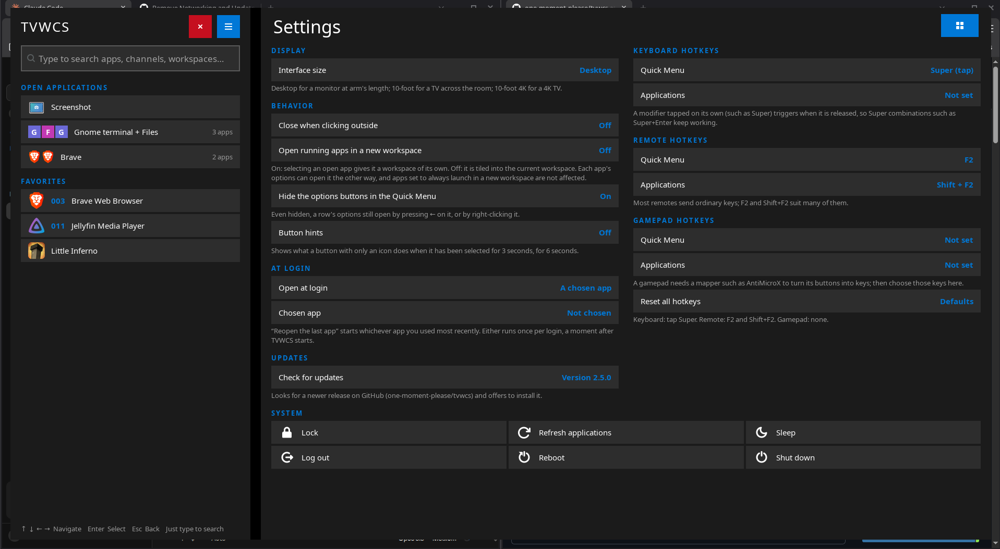

# TVWCS

TVWCS (TV Window Channel Switcher) is a remote-friendly, TV-style launcher and window switcher for ordinary Linux desktop applications on i3 or sway. It is not a media center and needs no app-specific plugins. See `PROJECT_OVERVIEW.md` for the goals behind it.

**New in 2.7:** sway support; installs into `~/.local/share/tvwcs` and sets up your i3 / sway config for you (or creates one); a hotkey for any application; a remote key for fullscreen, and fullscreen apps stay fullscreen; Arch, Fedora and systems without systemd; an on-screen password prompt when Reboot or Shut down needs one. See `CHANGELOG.md` for everything.

<table>
  <tr>
    <th width="25%">Quick Menu</th>
    <th width="75%">Quick Menu + Applications</th>
  </tr>
  <tr>
    <td valign="top"></td>
    <td valign="top"></td>
  </tr>
  <tr>
    <td valign="top">The Quick Menu, a full-height column at the left of the screen. The red ✕ closes it and ☰ opens Applications. Below the search field, <b>Open applications</b> lists what is running by workspace: Screenshot has a workspace of its own, while <i>Gnome terminal + Files</i> is one workspace holding 3 apps. <b>Favorites</b> are pinned apps, two of them with channel numbers (003, 011). Pressing ← on a row opens its options. The key hints are at the bottom.</td>
    <td valign="top">The Applications guide open beside the Quick Menu. <b>Channel Guide</b> lists the 4 profiles that have a channel number. <b>All applications</b> lists every installed app by category (Media, Internet, …); Enter folds a category. Each row shows the app's logo, channel, name and description, then a favorite star (★ when it is a favorite) and an edit button. <i>Jellyfin Media Player profile 2</i> is a second launch profile of Jellyfin, indented under it with a ↳. The ⚙ button at the top right switches to Settings.</td>
  </tr>
  <tr>
    <th colspan="2">Settings</th>
  </tr>
  <tr>
    <td colspan="2"></td>
  </tr>
  <tr>
    <td colspan="2" valign="top">Settings, in the same pane (the button at the top right goes back to the guide). The left column holds Display, Behavior, At login and Updates; each row shows its current value on the right, and Enter changes it. The right column holds the three hotkey sets: keyboard (tap Super for the Quick Menu), remote (F2) and gamepad (not set). The System actions sit in a grid underneath. (This screenshot is from 2.6: since 2.7 the right column also has the remote's Fullscreen key and an Application hotkeys section, and Behavior and At login have a setting more each.) This Quick Menu has its options buttons hidden, one of the Behavior settings.</td>
  </tr>
</table>

## Requirements

Linux with i3 (4.20 or newer) or sway, Python 3.9 or newer, GTK 4 and PyGObject. On i3, TVWCS uses `xdotool` to find the monitor under the pointer; sway reports it directly. systemd is not needed (see below). `install.sh` lists anything missing in your distribution's terms; for i3 (swap the window manager for `sway` and drop `xdotool` on sway):

```bash
sudo apt install python3-gi gir1.2-gtk-4.0 i3 xdotool        # Debian, Ubuntu, Linux Mint, Devuan
sudo pacman -S python-gobject gtk4 i3-wm xdotool              # Arch, Manjaro, EndeavourOS, Artix
sudo dnf install python3-gobject gtk4 i3 xdotool              # Fedora
sudo xbps-install python3-gobject gtk4 i3 xdotool             # Void
doas apk add python3 py3-gobject3 gtk4.0 i3wm xdotool          # Alpine
```

**Without systemd** (Artix, Devuan, Gentoo with OpenRC, Void, Alpine): everything works. Sleep, Reboot and Shut down use elogind's `loginctl` when it is installed, otherwise `zzz` / `reboot` / `poweroff`, which need root. Lock uses the first screen locker it finds (or `lock_command` in `config.json`). Without an `XDG_RUNTIME_DIR` (no elogind), TVWCS keeps its running files in `~/.cache/tvwcs`.

**When Sleep, Reboot or Shut down needs your password** (no systemd or elogind, or polkit refuses because another user is logged in): TVWCS asks for your sudo password in its own dialog. Type it on a keyboard, such as the one on the back of a remote, or, if it is all digits, on the on-screen keypad with the arrow keys. It goes straight to `sudo` and is never stored; a wrong one asks again (3 tries). With a no-password `doas` or `sudo` rule, nothing is asked. `install.sh` offers to add one (off unless you say yes): a sudoers file, `/etc/sudoers.d/zz-tvwcs-power-<you>`, or lines in `/etc/doas.conf`, allowing only `systemctl` / `loginctl` `suspend`, `reboot` and `poweroff`, and `reboot`, `poweroff` and `zzz` with no arguments. Delete that file to undo it.

## Install

Each method below installs TVWCS into `~/.local/share/tvwcs`. Your own data (channels, favorites, settings, hotkeys) is kept apart from the program, in `~/.config/tvwcs/`.

**From a release zip.** Extract the zip in a temporary folder and run its installer. You can delete the extracted folder afterwards.

```bash
cd "$(mktemp -d)"
unzip ~/Downloads/TVWCS-*.zip
./tvwcs/install.sh
```

**From the repository:**

```bash
git clone https://github.com/one-moment-please/tvwcs && cd tvwcs
./scripts/install.sh
```

The installer then sets up i3 and/or sway (whichever is installed). It asks before changing anything, and backs a config up as `config.tvwcs-backup` before it edits it:

- **You have a config:** it offers to add one line to it, and reloads the window manager if it is running:
  ```i3
  include ~/.local/share/tvwcs/tvwcs.conf
  ```
- **You have no config yet:** it offers to create one from the standard template (i3's own, as `i3-config-wizard` makes it, or sway's). It asks which key to use as `$mod` (Super or Alt) and whether to keep your current keyboard layout or use another (such as `de` or `us dvorak`).
- **TVWCS was installed in `~/.config/i3/tvwcs` before (2.6 and older):** it moves it to `~/.local/share/tvwcs`, offers to change your config's include line to the new place, points your hotkeys there, and offers to delete the old copy once nothing uses it.

Without a terminal to ask in, it changes no config and prints the line to add. `tvwcs.conf` starts TVWCS, loads your hotkeys and sets up its window rules. To install somewhere else, run `TVWCS_DEST=/some/path install.sh`; the installer points `tvwcs.conf` at that folder. `TVWCS_WMS=sway install.sh` sets up only sway (or only i3).

**Upgrading:** use **Settings › Check for updates**, or run the installer again from a newer zip or a fresh `git pull`. The installer replaces the program files but never changes your data. An install still in `~/.config/i3/tvwcs` is moved by either, the in-app update after it asks you. If TVWCS is running, it asks whether to restart it on the new version. If you edited `tvwcs.conf` by hand, your copy is saved as `tvwcs.conf.bak`.

## Using it

| Key | Action |
|---|---|
| **Super** tapped on its own (keyboard), **F2** (remote) | Show or hide the Quick Menu |
| *not set by default* | Open or close the Applications pane beside the Quick Menu |
| *not set by default* (remote) | Toggle fullscreen on the app you are using |
| **↑ ↓ ← →** | Move around. Pressing **→** past the end of the Quick Menu opens Applications |
| **Enter** | Launch, switch to, or activate the selected item |
| **Esc** / remote **Back** | Go back one step: close a dialog, then Settings, then Applications, then the Quick Menu |
| *any letter or digit* | Start a search. A channel number followed by Enter launches that channel; so do three digits (`007`) left alone for a second |
| **←** or right-click on a Quick Menu row | Open the row's options; they close again when you move away from them |

With **Settings › Button hints** on (it is off by default), an icon-only button that stays selected for 3 seconds shows its tooltip for 6 seconds, so a remote gets the same hints a mouse would.

Hotkeys come in three sets, one each for the keyboard, the remote and a gamepad, each with a key for the Quick Menu and one for Applications; the remote also has a key that toggles fullscreen on the focused app. Change them under **Settings › Hotkeys**; only the keyboard's Quick Menu key (tap Super) and the remote's (F2) are set to start with. A gamepad needs a mapper such as AntiMicroX to turn its buttons into keys first.

Any launch profile can also have a hotkey that launches it, set in its editor. **Settings › Application hotkeys** counts them and lists them to change or remove. A key does one thing: choosing one that is already in use warns you and asks before moving it.

From a terminal you can run `~/.local/share/tvwcs/bin/tvwcs` with `toggle`, `guide`, `stop` or `launch <profile id>`.

**Quick Menu:** search, then your open applications grouped by workspace, then your favorites. A row's options can open an app the other way (tiled here, or in its own workspace), run its `.desktop` actions, move a workspace to another monitor, expand a workspace into its apps, or close it.

**Applications:** the pane always opens on the applications guide. Categories fold with Enter. **Channel Guide** at the top lists every profile with a channel number. ☆ adds an app to your favorites, and ✎ (edit) manages its launch profiles. A profile can have a channel number, a launch mode (tiled or in its own workspace), a custom command or `.desktop` action, a description, a hotkey, and an optional PIN. Clicking the TVWCS window while an editor is open closes the editor without saving. The PIN is a convenience lock for a shared TV, not real security. The button at the top right switches between the guide and **Settings**.

**Settings** (two columns, with the system actions in a grid below): interface size (Desktop, TV Mode, and 4K TV Mode when a 4K display is connected), closing when you click outside, always opening apps in a new workspace, how running apps open, hiding the options buttons, button hints, keyboard / remote / gamepad hotkeys, an app to open at login, opening the Quick Menu at login, **Check for updates**, and system actions (Lock, Sleep, Log out, Reboot, Shut down). Log out, Reboot and Shut down ask you to confirm first.

## Troubleshooting

- **The hotkey does nothing:** start TVWCS once with `~/.local/share/tvwcs/bin/tvwcs`, then check `i3-msg -t get_config | grep -i tvwcs` (`swaymsg` on sway). If you see nothing, check your i3 version (4.20 or newer) and that `~/.config/tvwcs/hotkeys.conf` exists. Running `install.sh` creates it.
- **Tapping Super does nothing:** TVWCS binds it as `bindcode --release <keycode>` using your keyboard's keycode for the left Super key (usually 133). Check the line in `~/.config/tvwcs/hotkeys.conf`, and `xev` shows the keycode your key really sends. Some desktop tools (such as xcape, or a launcher bound to Super) can grab the key first.
- **"TVWCS is already running":** a stale `${XDG_RUNTIME_DIR:-/tmp}/tvwcs.pid` is left over. Stop that process or delete the file.
- **Wrong monitor or the menu covers your bar:** install `xdotool`, or raise `settings.margin` in `~/.config/tvwcs/config.json`. Stop TVWCS before editing that file.
- **Missing icons:** install an icon theme such as `adwaita-icon-theme`. Until then TVWCS shows text glyphs instead.
- **Check for updates fails:** TVWCS needs internet access to `api.github.com` and a published (non-beta) release on GitHub.

## Development

```
package/tvwcs/   application modules        package/tests/   unit tests (no display needed)
package/bin/     the tvwcs launcher         data/tvwcs.conf  the i3 config fragment
scripts/         install, tests, release    docs/RELEASES.md the beta → publish workflow
```

```sh
./scripts/run-tests.sh            # unit tests
./scripts/make-release.sh --beta  # build a test zip into resources/
```

Pushing to the `beta` branch builds a pre-release zip on GitHub. Pushing a `v*` tag publishes a release, which **Check for updates** then offers to installed copies.

## License and notes

MIT. See `LICENSE`. Most of this project's code was written by AI from a project description and rounds of revisions. You're free to copy, reuse or adapt it in any way.
