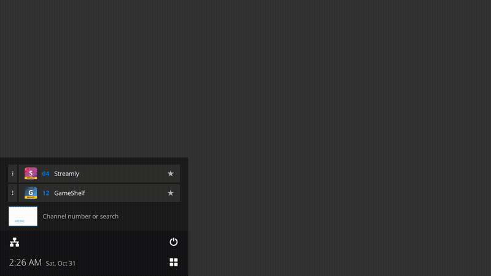
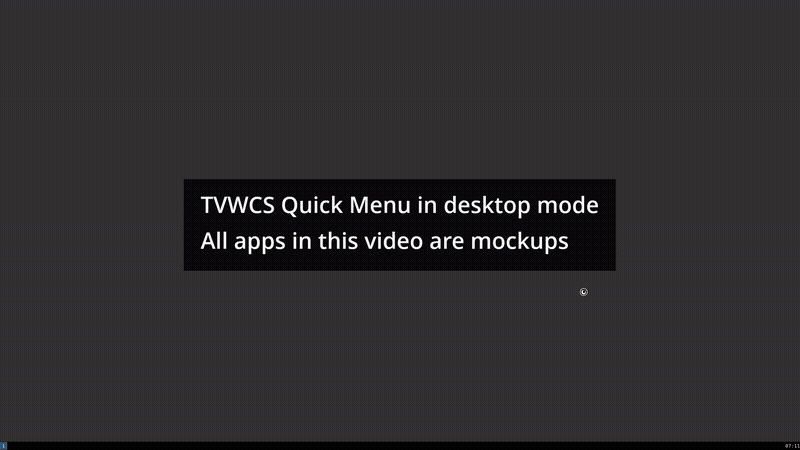

# TVWCS

TVWCS (TV Window Channel Switcher) lets you use an ordinary Linux computer from the couch with a remote. It runs on top of the sway window manager and gives you:

- a **Quick Menu** in a corner of the screen (the bottom left unless you choose another): your favorites, your open apps, search, and a status row with the clock, network, sound, Bluetooth and battery;
- an **Applications** pane beside it: every installed app by category, plus your own numbered **Channels**;
- a **Settings** app for the things a TV computer needs: sound, displays, Wi-Fi, Bluetooth, power, updates and more.

It works with normal desktop apps. It is not a media center and needs no plugins. What's new is in [CHANGELOG.md](CHANGELOG.md).

TVWCS has two modes:

- **TV mode** is the **TVWCS** session you pick at the login screen. It is made for a remote: every app opens full screen in a workspace of its own, the sway bar is off (the Quick Menu shows the time and status instead), the mouse pointer hides after 3 seconds, the Quick Menu stays open while nothing else is, and the computer locks with a swaylock screen in TVWCS's theme.
- **Desktop mode** is TVWCS inside your usual sway session. The Quick Menu is a launcher and switcher; apps open the way sway opens them, and your bar, pointer and lock screen are left as they are.

<table>
  <tr>
    <th width="25%">Quick Menu</th>
    <th width="75%">Quick Menu and Applications</th>
  </tr>
  <tr>
    <td valign="top"></td>
    <td valign="top"></td>
  </tr>
  <tr>
    <td valign="top">In desktop mode, "TVWCS" and ✕ close at the top (TV mode has no header). Below: one list of your favorites, then the other open applications (by workspace; ▴ unfolds the apps that share one, above it), then the search field. Favorites have a grey ★, and open apps a thin band down their left side. At the bottom, two rows: icons for network, volume, Bluetooth and the battery that each unfold a panel, with ⏻ power at the right; below them the time with the date beside it and, in the bottom-right corner, ⊞, which opens Applications.</td>
    <td valign="top"><b>Channels</b> lists apps you gave a number. <b>All applications</b> lists every app by category; OK/Enter folds a category. ☆ makes an app a favorite, ✎ edits it.</td>
  </tr>
  <tr>
    <th colspan="2">Settings › Appearance</th>
  </tr>
  <tr>
    <td colspan="2"></td>
  </tr>
  <tr>
    <td colspan="2" valign="top">Each row shows its current value on the right. OK/Enter changes it.</td>
  </tr>
</table>

### Demo videos

The apps in these videos are mockups made for the demo (a window with a still picture), labelled MOCKUP on screen. The previews below play on their own; click one to download the full-quality video (MP4).

<table>
  <tr>
    <th width="50%">TV mode</th>
    <th width="50%">Desktop mode</th>
  </tr>
  <tr>
    <td valign="top"><a href="https://github.com/one-moment-please/tvwcs/raw/main/assets/demo-tv-mode.mp4"></a></td>
    <td valign="top"><a href="https://github.com/one-moment-please/tvwcs/raw/main/assets/demo-desktop-mode.mp4"></a></td>
  </tr>
  <tr>
    <td valign="top">With the remote: open an app by its channel number, open a second one by channel, go back to the first from the Quick Menu's list, and open a third by searching its name. Each app gets a workspace of its own.</td>
    <td valign="top">With the keyboard and mouse, in the light theme: open apps by name so they tile side by side, fill a second workspace, switch between workspaces from the Quick Menu, then close one app and a whole workspace, unfold the power options above ⏻, and open Applications from ⊞ in the corner.</td>
  </tr>
</table>

## What you need

- **Debian, Ubuntu LTS (tested on 26.04), or another Debian-based system** (Linux Mint, Pop!_OS, Raspberry Pi OS), with **systemd**. On Ubuntu the installer offers to remove Snap, cloud-init and the Ubuntu Pro client (so does Settings > Software updates), and Settings > Network can hand Ubuntu Server's network (netplan with systemd-networkd) to NetworkManager.
- **sway.** apt installs it with TVWCS. (i3 was supported until 4.x.)

Other distributions and systems without systemd are not supported. [TODO.md](TODO.md) records what it would take to bring them back.

**New computer?** [Setting up a TV computer with Debian](docs/INSTALL-DEBIAN.md) goes from an empty computer to one that boots into TVWCS.

## Install

TVWCS comes as a Debian package, **tvwcs**, attached to each [release](https://github.com/one-moment-please/tvwcs/releases): the Quick Menu, Applications, Settings and the **TVWCS** session. apt installs what it needs with it (sway, swayidle, swaylock, GTK 4 for Python and so on).

The installer picks the release, asks a few questions and installs the package with apt. Run it in a terminal (not as root):

```bash
wget -qO- https://raw.githubusercontent.com/one-moment-please/tvwcs/main/install.sh | bash
```

With curl: `curl -fsSL https://raw.githubusercontent.com/one-moment-please/tvwcs/main/install.sh | bash`. Over SSH, sign in with `ssh -t` so the installer can ask its questions and sudo can ask for your password. You can also unpack a release's `tvwcs.tar.gz` and run its `./tvwcs/install.sh`: it then offers to install the package next to it, or to download another release. Or install the .deb yourself: `sudo apt install ./tvwcs_5.6.0_all.deb`.

### Starting TVWCS with the `tvwcs` command

Installing the package only adds the **TVWCS** session to the login screen. It changes no settings: no automatic login, and nothing in your sway config. Then `tvwcs` does what fits where you type it:

- **At a text console** (no graphical session, as on a computer with no login screen): it starts the TVWCS session, in TV mode. To have it start by itself, turn on **Settings › User › Log in automatically after startup**.
- **In your usual sway session:** it opens Settings and offers to add TVWCS to that session (one `include /usr/share/tvwcs/tvwcs.conf` line in your sway config), then asks for the key that opens the Quick Menu. Once TVWCS is part of the session, `tvwcs` shows the Quick Menu.
- **In another desktop** (GNOME, KDE, an X11 session): it opens Settings. The pages that only work in sway (Appearance, Remote and hotkeys, Displays, Power and sleep, and logging in) are shown turned off.
- **Over SSH:** it offers to start TVWCS on the computer's own screen, or to turn server mode on or off.

### Server mode

For a computer that is a server first and an HTPC second. One account uses the TV: it logs in automatically into TVWCS, and from TVWCS nobody can put the computer to sleep, restart it or shut it down, update it, change its network, or unmount its drives. The Quick Menu's power menu keeps only Lock (and Log out with a login screen). In Settings, Power and sleep, Software updates and Network are turned off, and every other setting that needs an administrator is hidden. A polkit rule backs this up for that account, whatever program asks.

- **Turn it on:** Settings › User › Server mode (an administrator, who chooses the account), or `tvwcs -s --user=NAME` in a terminal or over SSH (`NAME` is you by default; sudo asks for your password).
- **Turn it off:** Settings › User › Server mode asks for an administrator's password (and which administrator, from a standard account), or `tvwcs --no-server-mode`. The automatic login stays.
- **Start TVWCS on the screen now,** for example over SSH: `tvwcs --start --user=NAME`. It starts on the first free text console and logs NAME in there once.
- **A separate account for the TV** keeps the TV away from your own files. Create it yourself as a standard account (not an administrator), for example `sudo adduser tv`, then turn server mode on for it: `tvwcs -s --user=tv`.
- **Its password:** for a standard account that cannot sign in over SSH with a password, a numeric password of 6 digits (4 at the least) is enough for everyday use, and it is quick to type on a remote's number keys. Stop password sign-ins over SSH with Settings › System information › Sign in with › Keys only (for every account), or for this account alone with a `DenyUsers tv` line in a file in `/etc/ssh/sshd_config.d/`. Never give an administrator account a short numeric password: anyone at the TV could use it with sudo.

### What the installer asks

1. **Which version:** the latest release, the prerelease when there is one, or one of the two releases before the latest.
2. **Logging in automatically into TVWCS.** With no login screen, it offers to log you in on the first text console at startup, straight into TVWCS (logging out starts TVWCS again). With greetd, LightDM or SDDM, it offers the automatic login. With another login screen, choose **TVWCS** there.
3. **Your usual sway session.** TVWCS always has its own **TVWCS** session at the login screen, in TV mode. It asks whether to also add TVWCS to your usual sway session, in desktop mode (one `include /usr/share/tvwcs/tvwcs.conf` line in its config).

It asks all its questions first and changes nothing until you agree to the list of what it will do. Every file of yours it changes is backed up first as `<file>.tvwcs-backup`. Your own data (channels, favorites, settings, hotkeys) is kept in `~/.config/tvwcs/`.

**Upgrading from 4.x:** run the installer in a terminal once (4.x's updater can't install packages, and says so). It removes the old copy in `~/.local/share/tvwcs` and TVWCS's old login screen: another login screen installed on the computer takes over, or else greetd's text login, and the automatic login is kept. TV mode now runs on sway: the first TVWCS session makes its sway config from sway's standard one, without its bar (`~/.config/tvwcs/sway-session.conf`). TVWCS is taken out of an i3 config.

**Removing TVWCS:** `install.sh --remove` (or `sudo apt purge tvwcs`). It also takes TVWCS out of your usual sway config, ends the automatic login on the text console, and puts greetd back to its plain text login when it was starting TVWCS.

**For scripted installs:** `TVWCS_VERSION=latest` (or `package`, or a version such as `5.0.0`) answers which version.

## Using it with a remote

Most remotes act like a keyboard. TVWCS names their keys in its hints: **OK** is Enter, **Back** is Esc.

| Key | What it does |
|---|---|
| **F2** on a remote, or tap **Super** on a keyboard | Show or hide the Quick Menu |
| **↑ ↓ ← →** | Move. **→** past the Quick Menu opens Applications |
| **OK** / Enter | Open, switch to or choose the selected item |
| **Back** / Esc | Go back one step |
| **OK** on the empty search field | Open the on-screen keyboard (or number keypad) |
| Any letter or digit | Search. A channel number (000 to 999) then OK opens that channel. On a TV the search field starts three digits wide; typing a letter or a fourth digit widens it |
| **←** on a Quick Menu row (or right-click) | Open that row's menu |

- **Quick Menu layout:** it sits in the bottom-left corner, only as tall as what it shows. **Settings › Appearance › Quick Menu corner** puts it in any corner, mirrored to match: in a right-hand corner it runs right to left (← and → swap, and Applications opens to its left); in a top corner the status rows are at the top and its lists, search results and row options open downwards. What follows describes the bottom-left corner. Your favorites and open apps (one list, favorites first), search and the status row are at the bottom, with search results appearing above the search field. Favorites have a grey ★ and open apps a thin band down their left side, so a favorite that is open (shown once, in its place) has both. A name too long to fit scrolls by after it has been selected for 3 seconds. In TV mode the search field is three characters wide and shows **___** for a channel number. The date is short, such as "Sat, Oct 17".
- **Row options (⋯):** they unfold upwards, just above their row and indented a little. From the top: the app's own shortcuts (such as Settings' pages), open it this once the other way (**Open in new workspace** in desktop mode, **Open alongside …** the apps on screen in TV mode), and **Close this application** at the bottom, nearest the row. A workspace's can move it to another monitor. Back folds them away. **Settings › Appearance › Options buttons (⋯)** can hide the ⋯ buttons; ← on a row (or a right-click) still opens its options.
- **Workspaces with several apps:** the square ▴ button between ⋯ and the workspace's name unfolds its individual apps above it, to open just one; ▾ folds them again. On the name, ← moves onto it; ← again opens the row's menu.
- **Channels:** 000 to 999. Channel 000 opens Settings unless you give it to another app. Setting a channel shows three digit boxes; typing replaces the number.
- **Slow apps:** while an app takes a few seconds to open, a spinner turns in place of its icon in its button, so the screen is never blank, and the Quick Menu still opens.
- **Editing an app (✎):** opens its launch profile: a channel number, a hotkey, a Desktop Action (one of the app's own shortcuts), a custom command, a description and a PIN. **Copy** makes another profile from what is shown, such as Firefox in a private window; it is listed as "Firefox 2" (rename it to "Firefox Private"). The app's name itself never changes. A PIN-protected profile asks for its PIN first. The PIN is a lock for a shared TV, not real security.
- **Status panels:** network, volume, Bluetooth and battery icons unfold a panel above the status row: the connection and its address, **Find Wi-Fi networks** (choose one to connect; a password is asked when needed) and Wi-Fi on/off; mute and volume for output and input; the connected Bluetooth devices with Disconnect, **Find Bluetooth devices** (choose one to pair) and Bluetooth on/off; the battery's time left or time to full. Each has a button for its Settings page.
- **Power menu (⏻):** at the bottom right: Lock, Sleep, Reboot, Shut down; Log out when there is a login screen.
- **Applications:** ⊞ in the Quick Menu's bottom-right corner (or → on a row) opens Applications; ⊞ again closes it. If a power action needs your password, TVWCS asks for it on screen and never stores it.
- **Mouse and remote:** clicking with the mouse does not move the remote's selection.
- **On-screen keyboard:** wherever text is typed, the on-screen keyboard can be hidden (it starts that way), full, or a number pad; buttons on it switch, and it opens next time as you left it.
- **Other keys:** set the Quick Menu key for a keyboard, a remote or a gamepad in **Settings › Remote and hotkeys**, where the apps with hotkeys of their own are listed too. A gamepad needs a key mapper such as AntiMicroX.

From a terminal, `tvwcs` on its own does what fits where it runs (see [Starting TVWCS](#starting-tvwcs-with-the-tvwcs-command)); it also takes `start` (the launcher itself), `-s`/`--server-mode [--user=NAME]`, `--no-server-mode`, `--start [--user=NAME]`, `toggle`, `guide`, `stop`, `lock`, `launch <profile id>` or `settings [page]`.

## Settings

Open **TVWCS Settings** with channel 000, from a status panel's settings button, from Applications (under System), or with `tvwcs settings [page]`. Pages are tabs on the left: **→** enters a page, **Back** returns to the tabs. Text is typed on a keyboard or on the on-screen keyboard.

| Page (`tvwcs settings …`) | What it does |
|---|---|
| **Appearance** (`appearance`) | Interface size from 1 to 5 (3 is the desktop size and 4 the TV size; Auto is 4 in TV mode and 3 otherwise, a size smaller in Retro; a 4K switch doubles it for a 4K TV), the theme: Modern (dark or light, passed on to apps that follow the system's choice, with an accent colour and a background colour) or Retro (an old CRT TV's menus in green, amber or white, in pixel fonts, VT323 or Inter with icons to match, on a gray, blue or TV static background), closing TVWCS when it loses focus (on by default), and the screen edge margin for TVs that cut off the edges (overscan), set on a full-screen preview with a slider. |
| **User** (`user`) | Your name and password, server mode (see above), with "Administrator" or "Standard User" beside the page's title. Logging in automatically into TVWCS after start-up, on or off (greetd, LightDM or SDDM; without a login screen, on the first text console). The login screen in use, and switching to another one installed. The application to open at login (none, the last one used, or one you choose). |
| **Remote and hotkeys** (`hotkeys`) | In a sway session TVWCS isn't part of yet, **Add TVWCS to sway**. The Quick Menu key for the keyboard, remote and gamepad (clearing one asks first), and the apps that have a hotkey of their own (give one with ✎ on the app). **Reset all hotkeys** puts back the defaults and removes the app hotkeys. |
| **Sound** (`sound`) | Volume and mute for the output and the input in use. The others are folded under "2 inactive outputs" or "1 inactive input", which open and close. **Allow over-amplification** lets volumes go up to 150 % (off by default: volumes stop at 100 %). |
| **Displays** (`displays`) | Resolution, refresh rate, arrangement and scale for each display: a row of buttons from 75 % to 200 %. A change goes back after 15 seconds unless you keep it. |
| **Power and sleep** (`power`) | When the screen turns off, the computer locks and it sleeps (sway's swayidle times them; sound playing and apps that ask keep it awake). A laptop has these times twice, plugged in and on battery, and a choice of what to do when the battery is nearly empty. |
| **Bluetooth** (`bluetooth`) | Pair, connect and forget devices. Shows battery levels. |
| **Date and time** (`datetime`) | Time zone (one list), network time, 12- or 24-hour clock. |
| **Software updates** (`updates`) | System updates (apt), and TVWCS's own updates (including prereleases and rolling back), installed as packages. |
| **System information** (`system`) | Hardware and versions. Turns the SSH server on or off and shows how to connect. |
| **Network** (`network`) | Ethernet and Wi-Fi, and fixed IP settings. An Ethernet port the Debian installer set up (shown as "not managed"), or Ubuntu Server's netplan network, can be handed to NetworkManager; the old setup is kept as a backup, and on Ubuntu saved Wi-Fi networks and fixed addresses carry over. |
| **Storage** (`storage`) | Drives, with their partitions under them: mount and unmount partitions and safely remove drives. Partitions of the running system are marked as part of it. |

A page whose software is missing offers to install it (Sound installs PipeWire, Bluetooth BlueZ, and so on). When the Settings window is taller than it is wide (a tile, or a monitor turned on its side), the tabs show only their icons.

**Locking in TV mode:** the TVWCS session locks with swaylock. The lock screen follows your theme (Modern light or dark with your accent colour, or Retro with its colour, pixel fonts and background) and says it's locked and how to unlock it. A desktop session's own lock screen is not changed. `tvwcs lock` locks by hand. If the computer logs in automatically, **Settings › User › Lock the screen when TVWCS starts** has the session start locked, so your password is still needed after a restart.

## Update and uninstall

**Update:** **Settings › Software updates › Check for TVWCS updates** downloads the new packages and installs them with apt (it asks for your password), or run the installer again. Your data is never changed.

**Uninstall:** `install.sh --remove` (see above).

## Troubleshooting

- **The hotkey does nothing:** check that `swaymsg -t get_config | grep -i tvwcs` shows TVWCS and that `~/.config/tvwcs/hotkeys.conf` exists. Logging in to the TVWCS session again creates it.
- **Tapping Super does nothing:** another tool may grab the key. `wev` shows the keycode your key sends; compare it with the line in `hotkeys.conf`.
- **"TVWCS is already running":** delete the stale `$XDG_RUNTIME_DIR/tvwcs.pid`.
- **The edges of TVWCS are cut off on the TV:** raise **Settings › Appearance › Screen edge margin**, or turn off overscan in the TV's picture settings.
- **The TVWCS session doesn't start:** run `tvwcs-session` from a text console to see sway's errors. Its config is `~/.config/tvwcs/sway-session.conf`; delete it to make a fresh one from sway's standard config.
- **Letters instead of icons:** install `adwaita-icon-theme` or `papirus-icon-theme`.
- **Check for updates fails:** TVWCS needs internet access to `api.github.com`.

Developer notes (code layout, tests, releases) are in [PROJECT_OVERVIEW.md](PROJECT_OVERVIEW.md) and [docs/RELEASES.md](docs/RELEASES.md).

## License

MIT. See `LICENSE`. Most of the code was written by AI from a project description and rounds of review. You may copy, reuse or adapt it freely.
